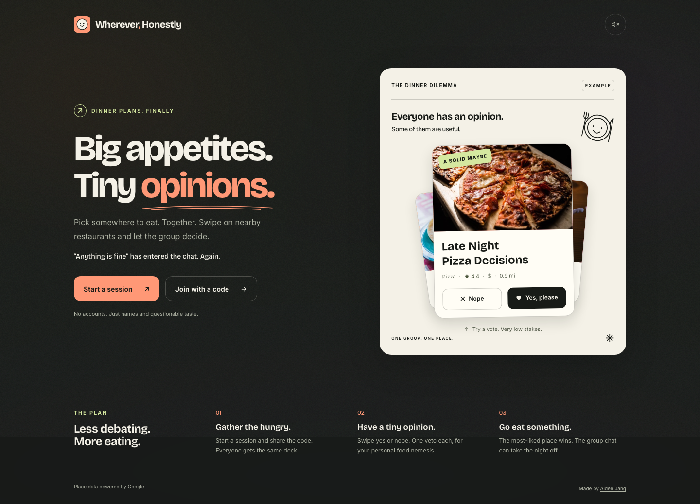

# Wherever, Honestly

Pick a restaurant together without another group-chat debate. Share a session,
swipe on one common deck, and turn the result into a dinner plan.

[Open Wherever](https://wherever.aidenjang.com)

## The experience

- No accounts: join with a name, code, invite link, or QR.
- Vote by gesture, buttons, or arrow keys. Undo a local vote before the round ends.
- The highest weighted score wins. Each person gets one super-like and one anonymous
  veto per round; a veto removes the restaurant from contention.
- Set food and location filters together in the lobby. Optional timers and host
  controls keep the group moving; voter identities stay hidden by default.
- Review the winner, ranked backups, directions, and visited history. Replay the same
  deck or deal new places from the reserve, then widen the search when needed.
- Send the dinner plan as text or save a ticket image with the address and map QR.
  The image uses no restaurant photo, participant names, individual votes, or extra provider call.
- Unavailable location searches preserve your query. Failed sharing leaves selectable
  text and an immediate retry; camera startup failures offer manual code entry.
- Install the PWA for shortcuts, invite sharing, a pending-card badge, and wake lock
  where the browser supports them. The cached interface can reopen offline;
  creating rooms and live voting require the network.

Google Places supplies live restaurant data. The sample source works without a key,
and a spent search budget falls back to clearly labeled sample restaurants.



## Run locally

Use current Node 22 (at least 22.22.2), or a supported runtime from `package.json`,
and the pinned pnpm version. `.nvmrc` selects the Node major.

```bash
corepack enable
pnpm install --frozen-lockfile
cp packages/worker/.dev.vars.example packages/worker/.dev.vars
pnpm --filter @wherever/worker run db:migrate:local
pnpm run dev:worker
```

In a second terminal, from the repository root:

```bash
pnpm run dev:web
```

The web app is on `http://localhost:5173`; Vite proxies API and socket traffic to
`http://127.0.0.1:8787`. Set `API_PORT` for the web app when choosing a different
Worker port. Local development defaults to the sample source through `.dev.vars`.
Live development uses its own local usage meter and may consume provider quota.

## Verify changes

Install the browser engines once:

```bash
pnpm --filter @wherever/web exec playwright install chromium webkit
pnpm run verify
```

Verification covers repository guards, documentation links, unused code, types,
lint, formatting, production build, emitted CSS, pure logic, Worker integration,
UI regressions, and Chromium/WebKit journeys against the real local Worker.
See [quality checks](docs/quality.md) for individual commands and review limits.

## Repository map

| Location           | Responsibility                                                                  |
| ------------------ | ------------------------------------------------------------------------------- |
| `packages/shared/` | Domain types, wire protocol, validation, voting, filtering, and display helpers |
| `packages/worker/` | HTTP routes, Durable Objects, D1, restaurant sourcing, and usage limits         |
| `packages/web/`    | React interface, room subscription, gestures, dialogs, and PWA behavior         |
| `scripts/`         | Repository and build checks                                                     |
| `docs/`            | Architecture, quality guidance, review evidence, and decision records           |

One Worker serves the built interface, `/api` routes, and WebSockets on the same origin.
Pushes to main run the complete CI check job. Deployment reuses that job's verified
client build, applies pending migrations, and publishes without rebuilding the client.

- [Architecture](docs/architecture.md)
- [Contributing](CONTRIBUTING.md)
- [Repository conventions](CONVENTIONS.md)
- [Design decisions](DECISIONS.md)
- [Hosting and configuration](DEPLOY.md)
- [Analytics and privacy boundaries](docs/ANALYTICS.md)
- [Visitor walkthrough](docs/visitor-review.md)

## License

[MIT](LICENSE) © Aiden Jang. Bundled font packages carry their own licenses.
