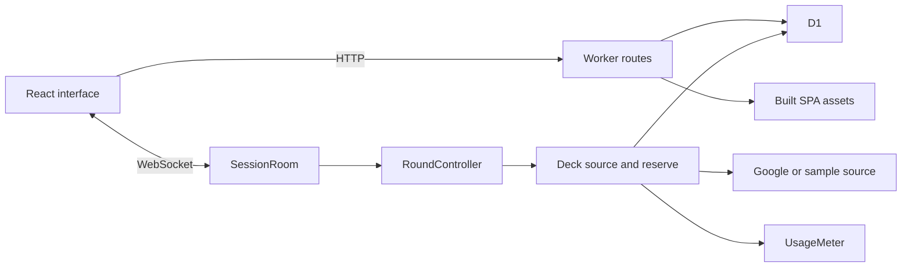

# Architecture

Current analytics: `analytics/` holds the fixed browser/Worker event contract, bounded
anonymous ingestion and credential-free transport. See [Analytics](ANALYTICS.md) for
coverage, privacy and dashboard queries. Private app paths are not traffic dimensions.

## Boundaries

| Layer       | Owns                                                                            | Does not decide                |
| ----------- | ------------------------------------------------------------------------------- | ------------------------------ |
| Shared      | Types, client validation, wire messages, pure winner/filter/format logic        | Network or storage             |
| Worker HTTP | Room creation, provider proxies, rate limits, asset delivery                    | Client screen state            |
| Room        | Identity, presence, host handover, round transitions and vote enforcement       | Browser gesture feedback       |
| Web         | Subscription lifecycle, forms, gesture state, dialogs, sharing, PWA affordances | Host rights or the final tally |

## A room's lifecycle

The HTTP create route validates filters, persists a D1 row, and initializes room
metadata. Join validates a client message and restores identity from a per-session
client ID. Socket attachments survive hibernation; connected participants are
deduplicated across reconnect overlap.

`SessionRoom` delegates voting and transitions to `RoundController`. A start or replay
guard spans external fetches and status writes. Only dealt restaurant IDs accept
votes, each participant's keyed vote replaces its predecessor, and undo removes
that participant's choice. Completion, the host, or the round alarm can decide.
The pure decision core ranks non-vetoed places and retains backups.

A host disconnect begins a grace deadline. Reassignment updates stored identities
and live attachments; the alarm schedules the earlier host/round deadline. Roster
and vote projections disclose only the fields allowed by the room's rules.

D1 holds session records and visited history; live metadata, votes, winner, decks,
reserves, and identity maps are in Durable Object storage. Pruning D1 does not
itself delete room storage. Neither table totals nor cached client data authorize
room operations.

## Restaurant data

`restaurantSource.ts` owns source selection, transport, and source-independent
filter predicates. `googlePlace.ts` normalizes provider fields and constructs
validated photo references. `deckSource.ts` combines vibe filters, visited cooldowns,
never-again choices, seen IDs, a shuffled or ordered deck, and its reserve.

A new round uses reserve data before another search. Exhausting the reserve widens
the radius; failure preserves the current result and permits retry. Same-deck
replays do not consume the new-search cap. Missing setup and exhausted budgets
carry distinct sample-data reasons.

The usage meter reserves search/photo calls before their upstream requests.
Geocoding uses the same atomic reservation meter, plus its own per-IP rate limit
and edge cache. Provider rejection returns a retryable service error; only a real
zero-result response is reported as a missing place. These are call limits, not
provider billing guarantees.

## Client composition and lifetime

`useSessionSocket` owns connection/retry mechanics and the per-room command buffer.
`sessionReducer` applies messages coherently. A room-code change resets the state
before paint; callbacks from old sockets and delayed transitions are ignored.
The route also keys room UI by code so dialogs, sharing, and announcements reset.

The lobby delegates invites and the active round to focused components. Voting
state stays with the deck, gestures with the active card, and round rules with
their own controls. Results separate winner presentation, copy generation, and
visited history.

Location results apply to the latest non-location filters; editing the query or
choosing a location cancels and invalidates an older lookup. Creation and location
requests have deadlines and are aborted when their form closes. Sharing uses one
guarded feedback hook for invites, plans, addresses, and history. Failure persists
with selectable text and retry; native cancellation returns to idle. Focus traps
cycle reachable dialog controls and restore the trigger.

The view-transition helper contains presentation failures without dropping a route
change or received decision. QR scanning releases camera tracks on close, failure,
or a successful scan. Wake locks release on hide or cleanup; late requests also
release their resources after their owner closes.
Server validation is imported through `@wherever/shared/schemas` so browser imports
of pure rules do not initialize or ship the validation library.

## Build and verification

The Worker serves hashed web assets and the SPA fallback. API and socket traffic
stay on the network. The service worker only refreshes its offline HTML from the
public homepage; room and share-target navigation cannot replace that shell.
Cached fingerprinted bundles need no background fetch, while stable assets revalidate.

CI checks the same ordered pipeline as `verify`, then a dependent delivery job
downloads the verified client artifact and applies migrations before publishing.

See [quality checks](quality.md), [design decisions](../DECISIONS.md), and the
[ADR directory](adr/0001-durable-objects.md).
