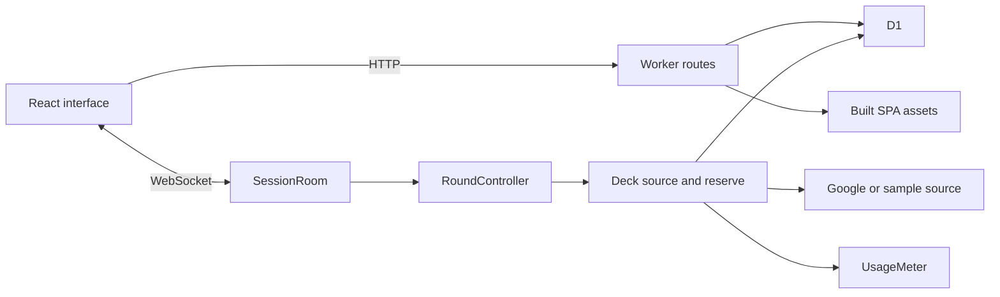

# Architecture

Current analytics: `analytics/` holds the fixed browser/Worker event contract, bounded
anonymous ingestion and credential-free transport. See [Analytics](ANALYTICS.md) for
coverage, privacy and dashboard queries. Private app paths are not traffic dimensions.

## Boundaries

| Layer       | Owns                                                                            | Does not decide                |
| ----------- | ------------------------------------------------------------------------------- | ------------------------------ |
| Shared      | Types, client validation, wire messages, pure winner/filter/format logic        | Network or storage             |
| Worker HTTP | Room creation, provider proxies, rate limits, asset delivery                    | Client screen state            |
| Room        | Identity, presence, host handover, round transitions and vote enforcement       | Browser gesture feedback       |
| Web         | Subscription lifecycle, forms, gesture state, dialogs, sharing, PWA affordances | Host rights or the final tally |

## A room's lifecycle

The HTTP create route validates filters, persists a D1 row, and initializes room
metadata. Join validates a client message and restores identity from a per-session
client ID. Socket attachments survive hibernation; connected participants are
deduplicated across reconnect overlap.

`SessionRoom` delegates voting and transitions to `RoundController`. A start or replay
guard spans external fetches and status writes. Only dealt restaurant IDs accept
votes, each participant's keyed vote replaces its predecessor, and Undo removes
only that participant's most recent choice. A round-scoped Undo state blocks
another step back until a new vote is cast. It is written in the ballot transaction
and sent on resume and private ballot updates. Completion, the host, or the round alarm can decide.
The pure decision core ranks non-vetoed places and retains backups.

Room creation reserves the host seat using the creator's browser credential. An
invite alone cannot grant the seat. Existing rooms without a recorded host ask
visitors to create a new room. A connected host's departure starts a grace
deadline. If no guest with a valid host credential remains when it expires,
the seat stays reserved for its current host. Reassignment updates the stored
owner and live attachments. The alarm also tracks round deadlines and room expiry.

D1 holds session records and past picks. Durable Object storage keeps room metadata,
votes, identity maps, and the deck and verdict references. Live Places records stay
in the active object’s display state, with only their place IDs persisted. New rooms expire seven
days after creation. Expiry clears both stores, closes sockets, and leaves only a
non-personal expired-code marker so late provider replies and reconnects cannot
restore the room. Writes check expiry inside storage transactions.

The daily sweep expires up to 20 indexed legacy rooms per run and retries failed
cleanup. Legacy objects whose D1 rows were already pruned cannot be enumerated;
they are erased on their next access. This is not a claim that historical orphan
objects have already been physically purged. Neither table totals nor cached
client data authorize room operations.

## Restaurant data

`restaurantSource.ts` owns source selection, transport, and source-independent
filter predicates. `googlePlace.ts` normalizes provider fields and constructs
validated photo references with author credits. `deckSource.ts` orders filtered
places by the group’s vibe without removing explicit requirements. It also keeps
track of past picks, exclusions, seen IDs, and the reserve.

A new round uses reserve data before another search. Exhausting the reserve widens
the radius; failure preserves the current result and permits retry. Same-deck
replays do not consume the new-search cap. Missing setup and exhausted budgets
carry distinct sample-data reasons.

The usage meter reserves search, details, photo, and geocoding calls before their
upstream requests. Details requests use the search allowance when a resumed room
needs live place data again. Photos and geocode responses are sent without a shared
cache. Provider failures preserve a retryable room, and an empty first search leaves
the filters editable. These limits count calls rather than provider charges.

## Client composition and lifetime

`useSessionSocket` owns connection and retry mechanics. Voting pauses on disconnect.
After reconnect, the server supplies the confirmed votes and active round, and any
unconfirmed card is offered again. Votes carry the round identifier.
`sessionReducer` applies snapshots and resets room state on a code change.
The route also keys room UI by code so dialogs, sharing, and announcements reset.

The lobby delegates invites and the active round to focused components. Voting
state stays with the deck, gestures with the active card, and round rules with
their own controls. Results separate winner presentation, copy generation, and
past picks.

Location results apply to the latest non-location filters; editing the query or
choosing a location cancels and invalidates an older lookup. Creation and location
requests have deadlines and are aborted when their form closes. Sharing uses one
guarded feedback hook for invites, plans, addresses, and history. Failure persists
with selectable text and retry; native cancellation returns to idle. Focus traps
cycle reachable dialog controls and restore the trigger.

The view-transition helper contains presentation failures without dropping a route
change or received decision. QR scanning releases camera tracks on close, failure,
or a successful scan. Wake locks release on hide or cleanup; late requests also
release their resources after their owner closes.
Server validation is imported through `@wherever/shared/schemas` so browser imports
of pure rules do not initialize or ship the validation library.

## Build and verification

The Worker serves hashed web assets and the SPA fallback. API and socket traffic
stay on the network. The service worker only refreshes its offline HTML from the
public homepage; room and share-target navigation cannot replace that shell.
Cached fingerprinted bundles need no background fetch, while stable assets revalidate.

CI checks the same ordered pipeline as `verify`, then a dependent delivery job
downloads the verified client artifact and applies migrations before publishing.

See [quality checks](quality.md), [design decisions](../DECISIONS.md), and the
[ADR directory](adr/0001-durable-objects.md).
